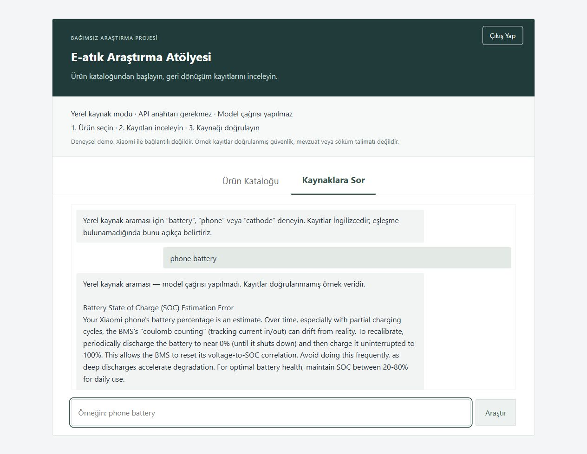

# E-waste research assistant

Türkçe e-atık araştırma demosu: ürün kataloğu, yerel geri dönüşüm kayıtlarından
anahtar sözcük tabanlı bilgi getirme ve OpenRouter üzerinden yanıt üretimi.
Xiaomi ile bağlantılı veya Xiaomi tarafından onaylanmış bir ürün değildir.



## Bu projede geliştirilen mühendislik

Projenin odağı yalnızca bir modele soru göndermek değil; ürün kayıtlarını,
kaynak getirmeyi ve kullanıcıya gösterilen çalışma modunu ayrı bir veri
akışında birleştirmektir.

- **Katalog normalleştirme:** [AIEngine](backend/ai_engine.py), JSON
  dosyalarını kararlı sırayla okuyup kategori/ad kimliğine göre yinelenen
  kayıtları ayıklar. Kimlikte ham ada ait SHA-256 özeti kullanılması, noktalama
  temizliğinin `X10` ve `X10+` gibi farklı ürünleri birleştirmesini önler.
  Mevcut yerel veriyle 11 dosyadan 127 ayrı ürün yüklenir; bu sayı katalog
  verisinin sonucu, güncel piyasa kapsamı iddiası değildir.
- **Açıklanabilir kaynak sıralaması:** [arama katmanı](backend/vector_db.py)
  sorgu sözcüklerinin component/category/action alanlarıyla kesişimini
  sırasıyla 3/2/1 ağırlıklarıyla puanlar. Perspektif filtresi ve açık
  eşleşme-yok sonucu vardır. Bu basit, deterministik yöntem embedding değildir;
  anlamsal benzerlik ve Türkçe–İngilizce eşleştirme kapasitesi sınırlıdır.
- **İki ayrı çalışma modu:** anahtarsız demo yalnızca yerel kayıtları getirir;
  model destekli yol OpenRouter kullanır. Modeli ben eğitmedim; bu projede
  geliştirilen kısım veri hazırlama, kaynak getirme, API ve arayüz entegrasyonudur.
- **Hata ve çıktı sözleşmeleri:** [Flask API](backend/app.py), geçersiz
  girdiler ve oturum hataları için JSON yanıtları üretir.
  [Tarayıcı istemcisi](static/app.js), yanıtları `textContent` ile gösterir;
  modelden gelen metni çalıştırılabilir HTML olarak eklemez.

**Neden bu yöntem?** Yerel sözcük araması ilk denemeyi API anahtarı, model
indirme veya ücretli çağrı olmadan tekrarlanabilir kılar. Buna karşılık arama
kalitesi veri sözcüklerine bağlıdır. [12 regresyon testi](tests/test_app.py);
ürün kimliklerini, oturum/girdi sözleşmelerini, loopback demo sınırını ve
anahtarsız yolda ağ çağrısı yapılmamasını denetler. Bunlar yanıtların bilimsel
doğruluğunu veya üretim güvenliğini kanıtlamaz.

## Yerelde çalıştırma

### Anahtarsız ilk demo

Bağımlılıkları aşağıdaki adımla kurduktan sonra `python -m backend.demo`
çalıştırın ve http://127.0.0.1:5055 adresini açın. Oturum açma veya API anahtarı
gerekmez. Bu açıkça seçilen demo yalnızca yerel loopback adresinde çalışır,
model çağrısı yapmaz; gerçek veri dosyasındaki eşleşen kayıtları gösterir.
“Kaynaklara Sor” alanında `phone battery` sorgusunu deneyin. Katalogdaki ürün
seçimlerinde eşleşme yoksa bu durum açıkça bildirilir; sonuç uydurulmaz.

### Oturumlu kullanım

Python 3.11+ gereklidir. PowerShell'de depo kökünden:

```powershell
python -m venv .venv
.\.venv\Scripts\python -m pip install -r requirements.txt
Copy-Item .env.example .env
# .env: kendi parolanızı, kalıcı SECRET_KEY ve OPENROUTER_API_KEY değerini girin.
.\.venv\Scripts\python -m backend.app
```

http://127.0.0.1:5000 adresini açın. `.env` içindeki kullanıcı/parolayla giriş
yapın, bir ürün seçip Analiz'e basın veya sohbet alanından soru sorun.
Model çağrıları harici servise gider ve ücret doğurabilir; anahtarınızı paylaşmayın.
API anahtarı yoksa yerel kaynak modu çalışır; anahtar varsa model destekli yanıt
üretimi kullanılır. Sağlık ekranı hangi modun etkin olduğunu bildirir.

## Doğrulama

```powershell
python -m unittest discover -s tests -v
```

Testler dış API çağırmaz. Gerçek model yanıt kalitesi ve Render yayını ayrıca
doğrulanmalıdır. Linux yayını: `gunicorn backend.app:app`; ortam değişkenlerini
`.env.example` doğrultusunda tanımlayın ve HTTPS için COOKIE_SECURE=true kullanın.

## Mimari ve sınırlar

- `backend/app.py`: oturum, ürün ve analiz API'leri.
- `backend/ai_engine.py`: katalog yükleme ve model istemleri.
- `backend/vector_db.py`: mevcut sonuç sözleşmesini koruyan deterministik sözcük araması.
- `data/`: örnek ürün ve geri dönüşüm kayıtları; doğrulanmış güncel mevzuat kaynağı değildir.
- `static/`: tarayıcı arayüzü.

Bu sürüm embedding veya vektör veritabanı kullanmaz. Model çıktısı doğrulanmış
kimyasal işlem, söküm talimatı veya mevzuat danışmanlığı değildir. Kaynakların
güncelliği, yanıtlarda kaynak gösterimi, oran sınırlama ve kapsamlı üretim güvenliği
henüz tamamlanmamıştır. İnternete açık üretim servisi olarak sunmayın.
